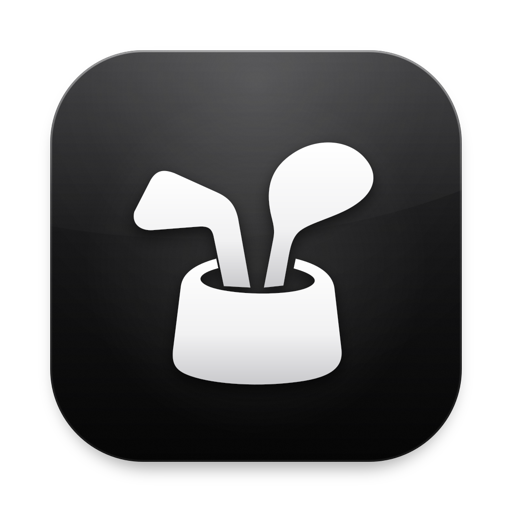
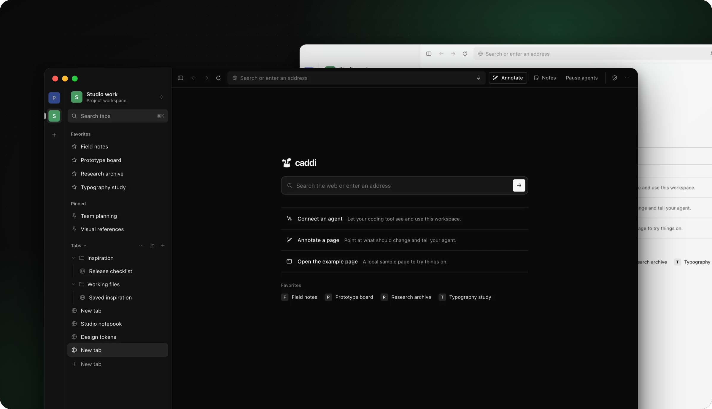
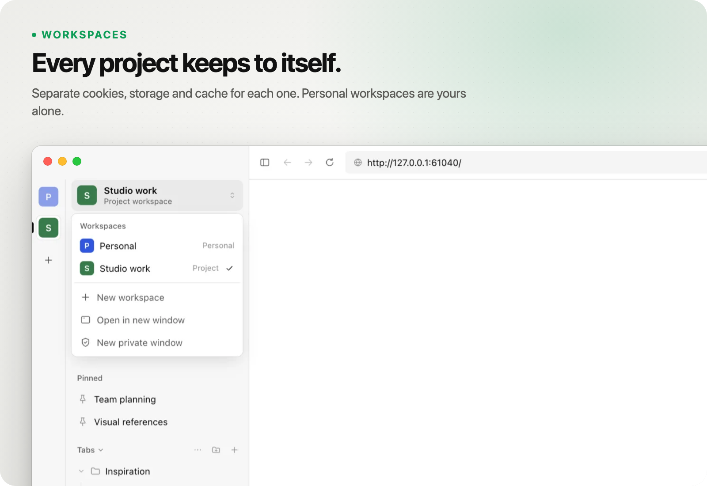
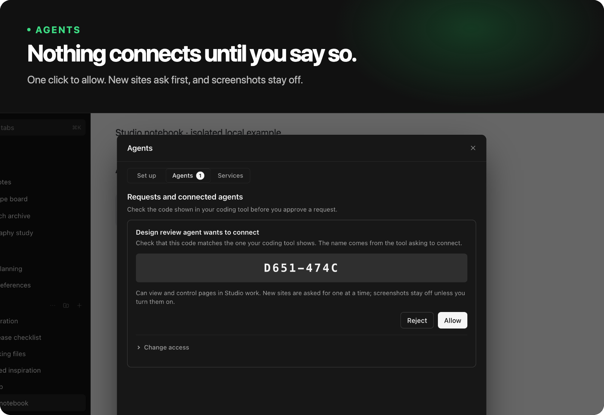
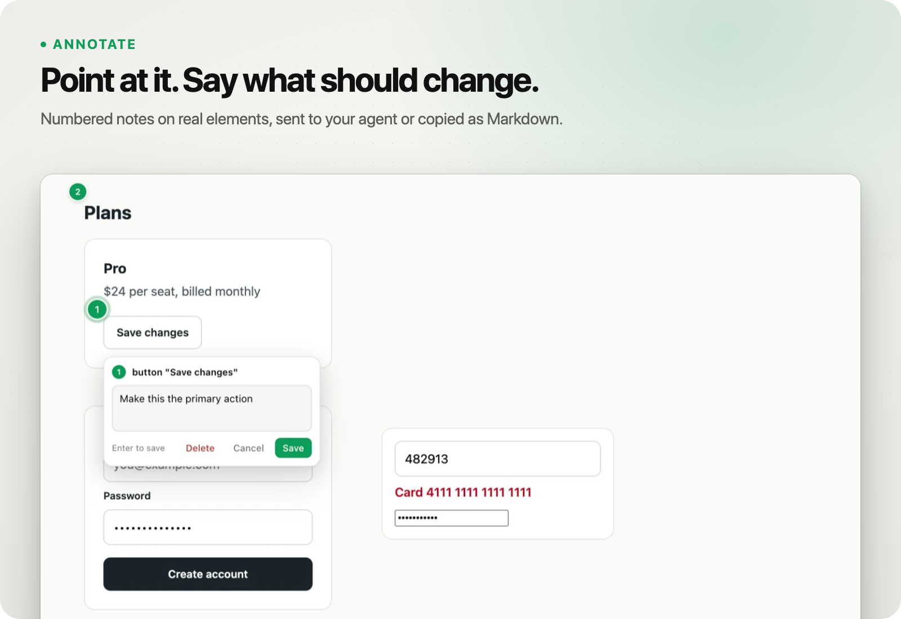
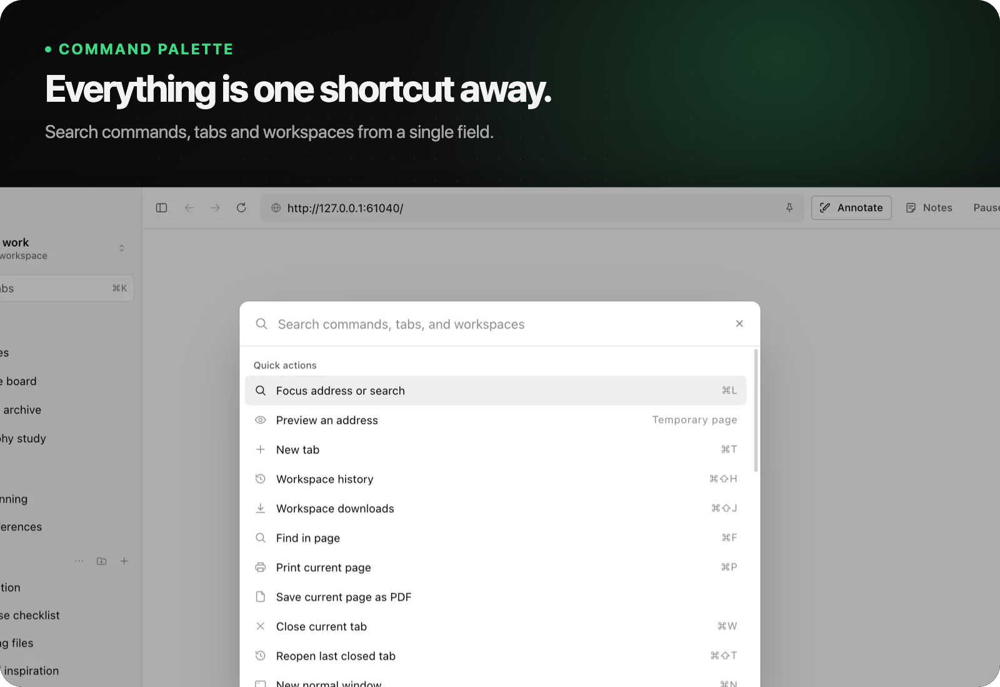

<p align="center">
  
</p>

<h1 align="center">Caddi</h1>

<p align="center"><strong>The Caddie for your coding agents.</strong></p>

<p align="center">
Caddi is a Mac browser built for working alongside coding agents.<br>
Keep every project in its own workspace, let agents in only where you approve, and point at exactly what should change.
</p>

<p align="center">
  <a href="LICENSE"></a>
  <a href="https://caddi.build/download"></a>
  <a href="https://github.com/ethanplusai/caddi/actions/workflows/ci.yml"></a>
</p>

<p align="center">
  <a href="https://caddi.build/download"><strong>Download for Mac</strong></a> ·
  <a href="https://caddi.build/docs">Documentation</a> ·
  <a href="docs/SECURITY-MODEL.md">Security model</a> ·
  <a href="docs/ROADMAP.md">Roadmap</a>
</p>

<p align="center">
  <a href="https://caddi.build"></a>
</p>

## What it is

Caddi is a browser first: vertical tabs, folders, split view, a command palette, history and downloads all work with no agent connected. What makes it different is how it treats the coding agents you work with.

- **Each project is sealed off.** Every workspace has its own cookies, storage and cache, so sign-ins for one client or app never mix with another.
- **Agents ask, you approve.** Claude Code, Codex, Cursor, OpenCode and other tools connect through a local MCP server, only after you approve them on screen, and only for the workspace and sites you choose.
- **You point, the agent fixes.** Click what should change on a page, write a note, and hand the notes to your agent with the element, its location in the code and your words.
- **It stays on your Mac.** No account, no sync service, no analytics and no crash reporting.

**Status:** early development preview for Apple Silicon Macs. Expect rough edges and breaking changes. It has not had an independent security review, so do not use it for accounts you cannot afford to lose.

## A look around











Screenshots show the app with sample data. They come from the interface test, `npm run test:ui`. The film at the top is the launch film from [caddi.build](https://caddi.build), without its sound.

## Features

- **Isolated project workspaces.** Every workspace has its own cookies, local storage and cache. Personal workspaces are human-only and can never be shared with an agent.
- **Workspace rail.** Every open workspace sits on the left edge as a badge, so switching projects is one click.
- **Vertical tabs.** A sidebar with tab groups, nestable folders, pinned tabs and favourites, plus a command palette for searching tabs and commands.
- **Private windows.** A throwaway session that is not saved to history and is invisible to agents.
- **One-click agent setup.** Caddi finds Claude Code, Codex, Cursor, Claude Desktop, Gemini CLI, Windsurf and OpenCode on your Mac and adds itself to their settings when you choose Connect.
- **Local MCP server for agents.** An agent asks to connect, you check its short code and choose Allow. The defaults are the current project workspace and the sites open in it, view and control, and no screenshots; **Change access** sets the workspace, the sites, observe or control, screenshots and saved logins. When a controlling agent wants a site it was not given, Caddi asks you.
- **Scoped, revocable access.** Agent sessions last up to eight hours and are never restored after a restart. Revoke an agent, or pause all agents in a workspace with one click.
- **Watch agents work.** An agent that drives a page shows a cursor with its name that moves to each target before it acts, and the toolbar says which agent is driving, with Take over. Agents can click, type, press keys, hover, choose options, drag, scroll, wait for the page and, only if you allow it, take screenshots.
- **Agents can read pages too.** An approved agent can read a granted page's content as Markdown (articles, docs, error pages, pricing tables) or pull out its links, tables, headings, metadata and form fields, in parts, only from the visible page and never from form fields. The toolbar shows when an agent is reading. **Copy page as Markdown** gives you the same text.
- **Sensitive-field protection.** Agents never see form values, and password, one-time-code and payment fields are hidden from them and cannot be filled by them.
- **Vault, per workspace.** Keep the logins a project needs in your Mac's login keychain. The key in the toolbar opens the Vault (a dot shows when this page has a saved login), where you fill, search, share and see who used each login. Caddi offers to save a login when you sign in yourself, and imports a CSV from 1Password, Apple Passwords, Bitwarden, Dashlane, LastPass or Chrome. If you choose, an approved agent can sign in with a login after you confirm, without ever seeing the password, and every use and attempt is in the Vault's Activity. Caddi has no account and nothing syncs. No passkeys or password generation.
- **Annotate.** Click elements on a page, write a note on each, then copy the notes as Markdown or send them to a connected agent. The count beside Annotate opens **Sent to agents**, which shows everything you sent and whether the agent received it. An agent that is waiting on `caddi_live_wait` gets your notes the moment you send them.
- **Live.** Talk while pointing at the page. Each sentence goes to a connected agent as you say it, with the elements you pointed at, and you watch the fix land. The agent can answer on the page: its reply appears in the toolbar and the element it means is outlined. Stopping keeps the sentence you were saying and anything the agent has not picked up yet. Speech is transcribed on your Mac; you can also type.
- **Board, per workspace.** A place for a project's notes, links, pinned and snapped pages, and pasted or dropped images, arranged by dragging. Connected agents can read the board, and with control they can add notes. You can point at board cards in Live.
- **Everyday browser basics.** Split view, find in page, zoom, per-workspace history and downloads, print and save as PDF, bookmark and workspace import and export, configurable keyboard shortcuts, light and dark appearance.
- **Reviewed links and permissions.** Links from other apps wait for you to pick a workspace. Sites must ask before using notifications, camera or microphone, and pop-ups are blocked by default.

Read-only service connections for GitHub, Vercel and Resend are implemented but cannot be used with real credentials yet. See the [roadmap](docs/ROADMAP.md).

## Install

**Signed build.** A signed, notarized build for Apple Silicon Macs is at [caddi.build/download](https://caddi.build/download). Confirm an email address, open the disk image, drag Caddi to Applications and open it. Nothing else is needed: a connected coding tool starts Caddi's MCP client with the app itself, so you do not have to install Node.js.

**From source.** You need macOS on Apple Silicon and Node.js 22.12 or newer.

```sh
git clone https://github.com/ethanplusai/caddi.git
cd caddi
npm ci
npm start
```

`npm ci` downloads the Electron runtime. Your browsing data for a source run stays in `.caddi-development/` inside the checkout.

The first time Caddi opens, a short welcome walks through naming a workspace, connecting a coding tool and the two shortcuts worth knowing. It is under **Help, Welcome to Caddi** afterwards.

## Connect an agent

1. In Caddi, open the Agents dialog. It lists the coding tools found on your Mac.
2. Choose Connect next to Claude Code, Codex, Cursor or another listed tool, then start that tool. For any other tool, copy the MCP configuration and paste it into the tool's settings.
3. Caddi shows the request in the sidebar and the Agents dialog. Check that its code matches the one the tool prints.
4. Choose Allow. To pick a different workspace, observe-only access or screenshots first, open **Change access**. If a controlling agent later wants a site it was not given, Caddi asks you.

The agent can now list its workspace, read page structure and wait for pages, and, if you allowed control, navigate, click, type, press keys, hover, choose options, drag and scroll on the approved sites while you watch its cursor. Full details and the list of MCP tools are in [docs/CONNECTING-AGENTS.md](docs/CONNECTING-AGENTS.md).

## Annotate a page

1. Open the page and press Annotate in the toolbar (or Cmd+Shift+A).
2. Click an element and write what should change. Repeat for as many elements as you like.
3. Copy the notes as Markdown, or send them to a connected agent. The bar, and the Sent list next to Annotate, say when the agent has received them.

For a running conversation instead, press Live (or Cmd+Shift+L), ask your agent to start a Caddi live session, then point and talk. See [Connecting agents](docs/CONNECTING-AGENTS.md#live-talk-while-pointing).

## Keyboard shortcuts

Change any of these in Settings, Keyboard shortcuts (Annotate and Live are fixed).

| Shortcut | Action |
| --- | --- |
| Cmd+T, Cmd+W, Cmd+Shift+T | New tab, close tab, reopen closed tab |
| Cmd+L, Cmd+K, Cmd+F | Address or search, commands and tab search, find in page |
| Cmd+Shift+H, Cmd+Shift+J | Workspace history, workspace downloads |
| Cmd+N, Cmd+Shift+N | New normal window, new private window |
| Cmd+P, Cmd+R, Option+Left/Right | Print, reload, back and forward |
| Cmd+Shift+U | Vault: fill this page's saved login (or choose one), or open the Vault |
| Cmd+Shift+A, Cmd+Shift+L | Annotate, Live |

## Documentation

- [Architecture](docs/ARCHITECTURE.md): processes, trust boundaries, state model, where data lives
- [Connecting agents](docs/CONNECTING-AGENTS.md): setup, approval, scopes, MCP tool reference
- [Security model](docs/SECURITY-MODEL.md): threat model, protections, known limits
- [Development](docs/DEVELOPMENT.md): running, testing, packaging, conventions
- [Roadmap](docs/ROADMAP.md): what is not done yet
- [Contributing](CONTRIBUTING.md), [code of conduct](CODE_OF_CONDUCT.md), [support](SUPPORT.md) and [reporting security issues](SECURITY.md)
- [Changelog](CHANGELOG.md), [third-party notices](THIRD_PARTY_NOTICES.md) and [provenance](PROVENANCE.md)

## License

Caddi's source code is released under the [MIT License](LICENSE).

Electron, Chromium and other third-party components keep their own licenses. See [THIRD_PARTY_NOTICES.md](THIRD_PARTY_NOTICES.md). The Caddi name and logo are not covered by the MIT License.
